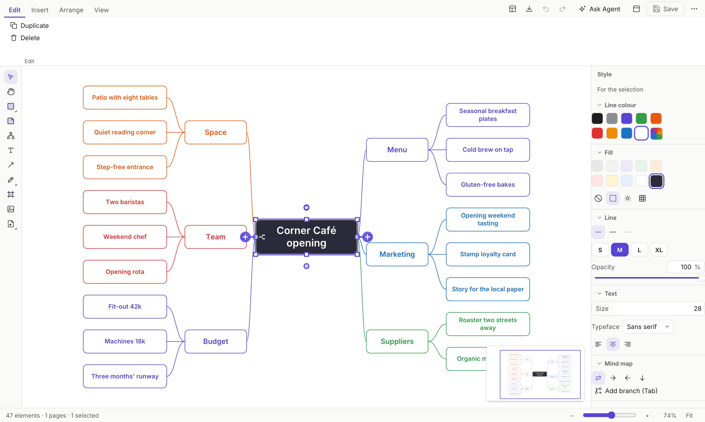
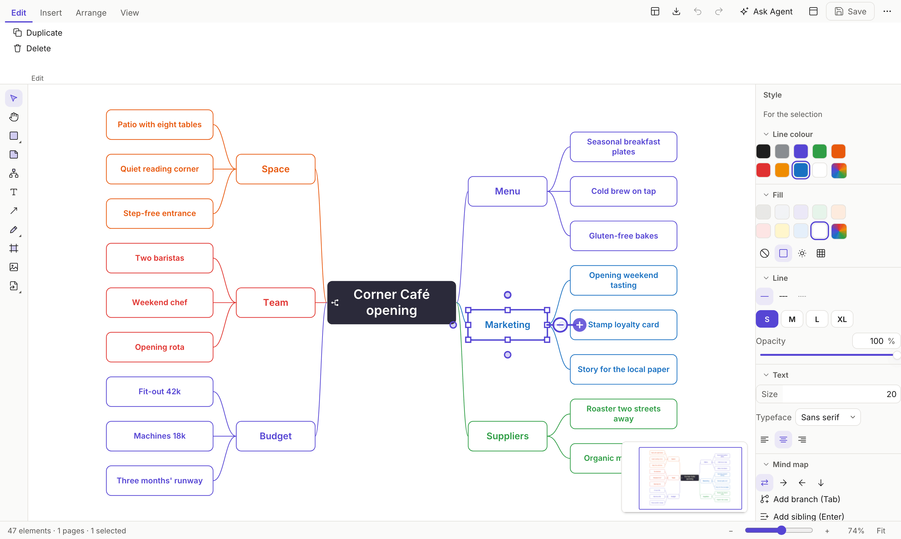
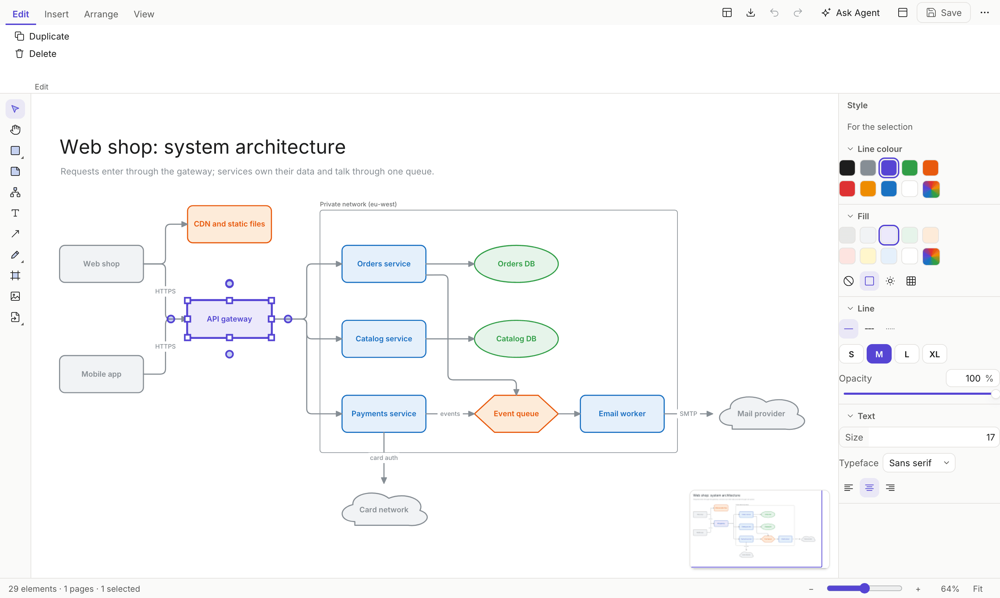
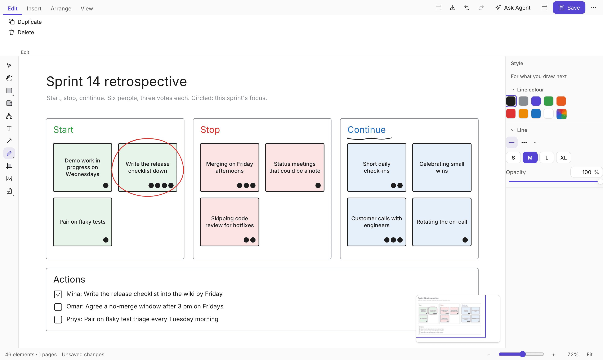
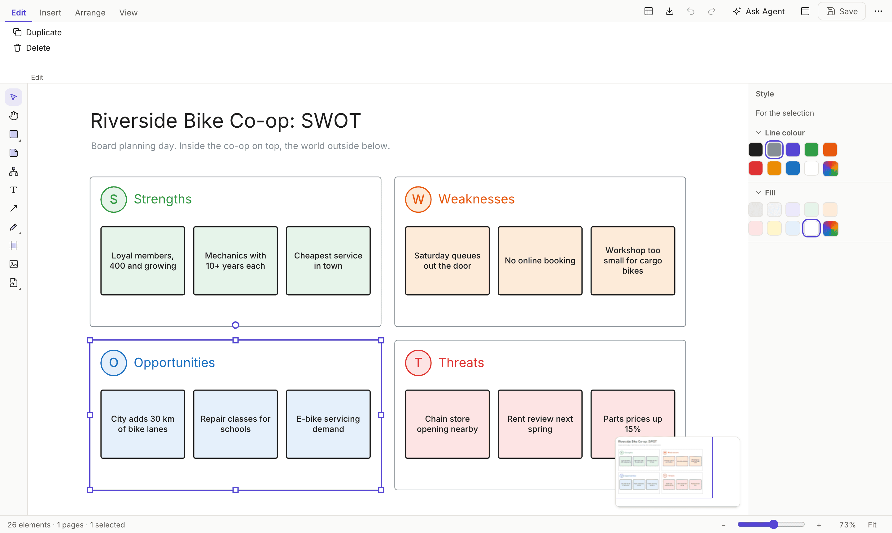
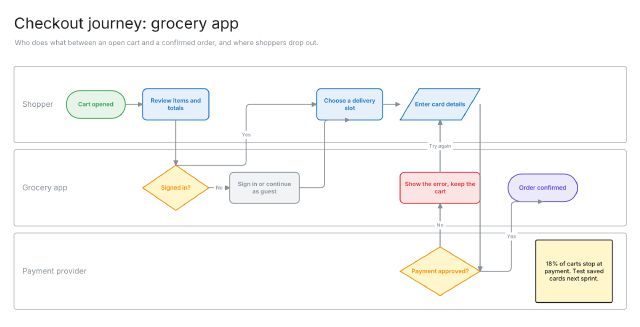
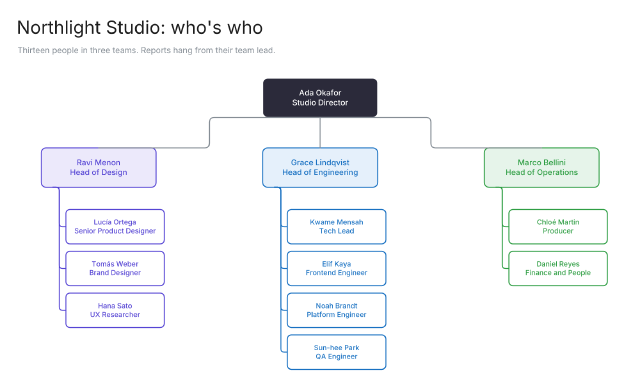
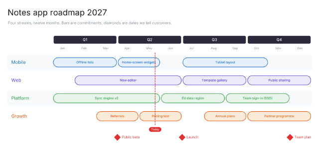
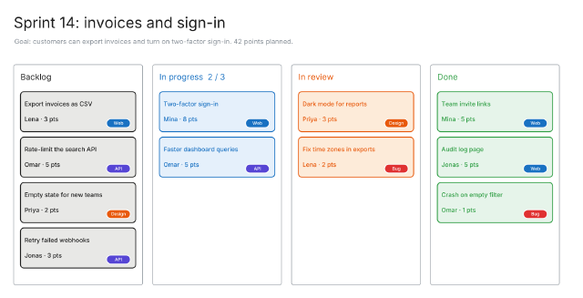

<div align="center">

# Kition Board

**Kition Board: an infinite whiteboard for diagrams, mind maps and sketches, for people and AI agents**

Shapes and connectors · Mind maps · Sticky notes · Freehand · Frames · MCP tools for agents

[](LICENSE)
[](https://www.npmjs.com/package/@kition/embed)
[](https://github.com/kitharness/kitharness)
[](bindings/wasm)

[Use it in Kition](https://kition.ai) · [Embed it](#embed-it-in-your-app) · [Give it to your agent](#give-it-to-your-agent) · [Showcase](https://github.com/KitionAI/kition-showcase/tree/main/board) · [Developer docs](https://developer.kition.ai) · [KHP](https://github.com/kitharness/kitharness)

</div>

A whiteboard is where a plan starts, and too often where it stays. The diagram lives in one web
app, behind one account. An AI agent can describe a flow chart in text, but it cannot draw one on
the board you are using. So you redraw its answer by hand.

Board keeps a whiteboard in a `.kboard` file on your disk. You draw shapes, sticky notes,
connectors, frames and mind maps on an infinite canvas. An AI agent works on the same file through
the same engine: it reads the board, adds and connects elements, lays out a mind map, and checks
for loose ends before you look.



## What it does

### Why Board

- **Shapes that stay connected.** Eighteen shapes, text and sticky notes. Connectors stay bound to
  the shapes they join, with labels and waypoints.
- **Mind maps that lay themselves out.** Add a branch or a sibling with one key, collapse a branch,
  and choose which way the map grows.
- **Think with your hands.** Freehand strokes with the pen, pictures with alternative text, and
  align, distribute and stack for tidy layouts.
- **Frames and pages.** Frames hold and fit what is inside them. Pages keep one board in parts:
  create, rename, duplicate, reorder.
- **Built for agents.** An agent extends a flow chart, answers on the board, fixes what the check
  reports, and can work in a draft you review.
- **Your file, open source.** A board is a `.kboard` file you keep. Engine and editor are
  Apache-2.0.

### See it

<table>
<tr>
<td width="50%"><br /><b>Mind maps</b>: select a node to add a branch or a sibling, collapse it, or change the map's direction.</td>
<td width="50%"><br /><b>Shapes and connectors</b>: move a shape and its connectors follow, labels and arrowheads included.</td>
</tr>
<tr>
<td width="50%"><br /><b>Sticky notes and freehand</b>: sort ideas on notes, then circle and underline with the pen.</td>
<td width="50%"><br /><b>Frames</b>: a frame holds its notes and fits around them.</td>
</tr>
</table>

### Made with Board

<table>
<tr>
<td width="25%"><a href="https://github.com/KitionAI/kition-showcase/tree/main/board/checkout-user-journey"></a></td>
<td width="25%"><a href="https://github.com/KitionAI/kition-showcase/tree/main/board/design-studio-org-chart"></a></td>
<td width="25%"><a href="https://github.com/KitionAI/kition-showcase/tree/main/board/notes-app-roadmap-2027"></a></td>
<td width="25%"><a href="https://github.com/KitionAI/kition-showcase/tree/main/board/sprint-kanban-board"></a></td>
</tr>
</table>

Every sample is built with Board's own commands. [See all of them](https://github.com/KitionAI/kition-showcase/tree/main/board).

### Formats

| Opens | Creates | Exports |
| --- | --- | --- |
| `.kboard` | `.kboard` | `.png`, `.svg`, `.pdf` |

## Quick start

### Use it in Kition

Kition ships Board: a `.kboard` file in your workspace opens in this editor. Kition's agent edits
the same board with the kit's `board_*` tools. [Download Kition](https://github.com/KitionAI/kition/releases/latest).

### Embed it in your app

Board's editor is a static package you host yourself, mounted into your page with the Kition SDK's
[`@kition/embed`](https://www.npmjs.com/package/@kition/embed). You keep the files and the users;
the editor reads and writes through the functions you give it.

1. Download `kition-board-<version>.tgz` from the
   [latest release](https://github.com/KitionAI/kition-board/releases/latest) and serve its
   `board-ui/` folder as static files on its own origin, with the headers in the
   [embed reference](https://github.com/KitionAI/kition-sdk/blob/main/docs/platform/reference/embed.md).
2. Install the SDK and mount the editor:

```sh
npm install @kition/embed
```

```ts
import { KitionEmbed } from '@kition/embed'

const editor = await KitionEmbed.mount(document.getElementById('board')!, {
  kit: { id: 'kit.board', url: 'https://kits.example.com/board-ui/' }, // the package you host
  file: { id: 'cafe-launch', name: 'Cafe launch.kboard' },
  storage: {
    read: async (id) => api.read(id),                    // { bytes, version }
    write: async (id, bytes, { expectedVersion }) =>     // refuse a stale version
      api.write(id, bytes, expectedVersion),             // { version }
  },
})
```

Every save carries the version it read, so an edit made elsewhere is never written over. The
[embed guide](https://github.com/KitionAI/kition-sdk/blob/main/docs/sdk/embed.md) covers identity,
co-editing and an agent working inside the open editor.

### Give it to your agent

The engine also runs headless, and `kition`, the Kition SDK's command line, serves it as MCP tools
(`board_inspect`, `board_run`, `board_check`, ...) on a folder of boards, for any MCP client.
Nothing is compiled: you need neither Rust nor the Kition app. Install `kition`, then connect your
agent in the folder:

```sh
npm install -g @kition/cli        # Node.js 20 or later; gives the kition command
kition agent add claude           # or codex, cursor: registers kition's MCP server
```

Without installing it:
`claude mcp add kition -- npx -y @kition/cli mcp --workspace "$PWD"`. Without Node.js, install
`kition` with `curl -fsSL https://github.com/KitionAI/kition-sdk/releases/latest/download/install.sh | sh`
(Windows: `irm https://github.com/KitionAI/kition-sdk/releases/latest/download/install.ps1 | iex`)
and run the same `kition agent add`.

`kition` holds no kit. The first time the agent opens a `.kboard` file, through the `kit_inspect`
tool the server offers until Board is installed, `kition` downloads Board's headless executable into
`~/.kition/kits` and the board tools appear. `kition kit install board` downloads it ahead of time,
and `kition kit upgrade` moves it to the newest version. Claude Desktop, Cursor, Codex and the other
commands are in the SDK's
[agent guide](https://github.com/KitionAI/kition-sdk/blob/main/docs/sdk/agent.md#connect-your-agent)
and [`kition` guide](https://github.com/KitionAI/kition-sdk/blob/main/docs/sdk/cli.md). To run a
build of your own (working on the kit itself), see
[docs/development.md](docs/development.md#build-and-check).

A real session on a copy of the showcase mind map, abridged:

```text
> board_inspect {"path":"cafe.kboard","preview":false}
Opened `cafe.kboard`: 1920 × 1080
  Page 1: 47 elements

> board_query {"path":"cafe.kboard","follow":"pages.0.elements","fields":["kind","text"]}
Read 47 objects of `cafe.kboard`.
  79e2d06f-… shape "Corner Café opening" · d1c80ccb-… shape "Marketing" · 476ca04e-… shape "Space" · …

> board_run {"path":"cafe.kboard","steps":[
    {"command":"mindmap.addChild","params":{"node":"d1c80ccb-…","text":"Chalkboard sign out front"}},
    {"command":"mindmap.collapse","params":{"node":"476ca04e-…","collapsed":true}}]}
Ran 2 commands on `cafe.kboard` (saved): 1920 × 1080 Changes: objects 2 created, 28 changed.

> board_inspect {"path":"cafe.kboard","preview":false}
  Page 1: 49 elements

> board_check {"path":"cafe.kboard"}
Checked `cafe.kboard`: the kit found nothing wrong.
```

The new branch and its connector are the 2 objects created; the 28 changed are the nodes the map
laid out again. Ids and element lists are trimmed from the JSON the tools answer. The agent's guide
is [agent/guide.md](agent/guide.md).

## Maturity

Version 0.1.2 · KHP 1.0, conformance level `basic`.

| Works today | Partly there | Not yet |
| --- | --- | --- |
| Shapes, sticky notes and text: move, resize, rotate, style, group, lock<br />Connectors bound to shapes, with labels and waypoints<br />Mind maps, frames and pages<br />Freehand strokes and pictures with alternative text<br />Align, distribute and stack | Cards that link to a file or a web page<br />Live co-editing in the editor<br />Export to PNG, SVG and PDF<br />Undo and redo<br />Templates | — |

Known gaps: [docs/gaps.md](docs/gaps.md). What's next: [docs/roadmap.md](docs/roadmap.md).

## Build and contribute

Build and test instructions are in [docs/development.md](docs/development.md). Read
[CONTRIBUTING.md](.github/CONTRIBUTING.md) before opening a pull request, and ask questions in
[Discussions](https://github.com/KitionAI/kition/discussions) or on [Discord](https://discord.gg/bFSjRDjVY).

## License

Apache-2.0 ([LICENSE](LICENSE)). Third-party licenses and notices are listed in [NOTICE](NOTICE)
and [docs/attribution.md](docs/attribution.md).
